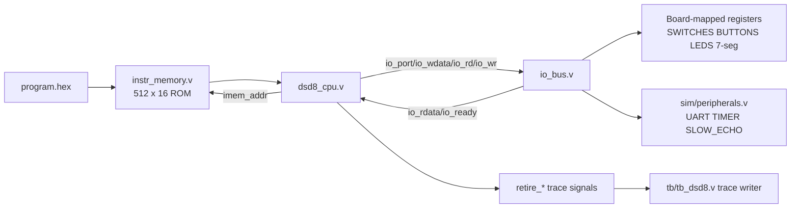
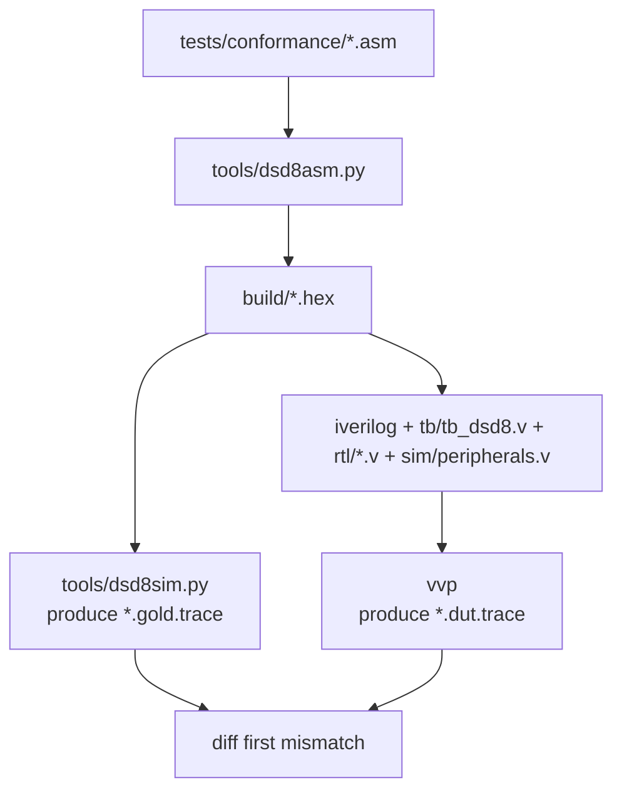

# LLM Guide: DSD8 Gates of Dispair

## 1) Project Purpose
This repository is a **starter/certification framework** for a DSD-8 CPU project, not a finished CPU implementation. Most RTL modules in `rtl/` are placeholders with frozen interfaces and TODO logic.

## 2) Non-Negotiable Constraints
1. **Frozen RTL ports**: do not rename/resize module ports in frozen interfaces.
2. **Trace compatibility**: `tb/tb_dsd8.v` depends on `dsd8_cpu` trace ports exactly as-is.
3. **Retirement semantics**: `retire` must pulse exactly once per retired instruction, in-order.
4. **Unit testbench output contract**:
   - `TESTBENCH: PASS`
   - `TESTBENCH: FAIL (N errors)`
5. **Conformance is trace-based**: golden trace from `tools/dsd8sim.py` is the oracle.

## 3) Overall Architecture Diagrams

### 3.1 Runtime hardware architecture (simulation and board top-level)

### 3.2 Verification/conformance pipeline

## 4) File-by-File: What Must Be Done

## 4.1 `rtl/` (core implementation work)

### `rtl/dsd8_cpu.v`
- **Status**: placeholder.
- **Must do**:
  - Integrate submodules (`prog_counter`, `instr_decoder`, `register_file`, `alu`, `flags_reg`, `data_memory`, `control_unit`).
  - Implement fetch/decode/execute/writeback dataflow.
  - Correctly drive all `retire_*` outputs per retired instruction.
  - Implement I/O handshake behavior with `io_ready` stalls.

### `rtl/dsd8_top.v`
- **Status**: placeholder.
- **Must do**:
  - Instantiate and wire `dsd8_cpu`, `instr_memory`, and `io_bus`.
  - Connect board inputs/outputs and halted indicator.

### `rtl/prog_counter.v`
- **Status**: reset-only behavior implemented; no advance/load logic.
- **Must do**:
  - `pc=0` on active-low synchronous reset.
  - If `pc_en=1`: `pc_load ? branch_addr : pc+1` with 9-bit wrap.
  - If `pc_en=0`: hold PC.

### `rtl/instr_decoder.v`
- **Status**: outputs tied to zero.
- **Must do**:
  - Pure combinational bit-slice extraction from `instr` for all fields.
  - Do not gate output fields by opcode.

### `rtl/register_file.v`
- **Status**: reset clears regs; reads/writes not implemented.
- **Must do**:
  - Synchronous write when `we=1`.
  - Combinational reads `rd1=regs[ra1]`, `rd2=regs[ra2]`.
  - Preserve old-value read behavior for same-cycle read/write as required.

### `rtl/alu.v`
- **Status**: outputs tied to zero.
- **Must do**:
  - Implement arithmetic/logical/shift/CMP ops for opcodes `0x4..0xB`.
  - Implement flags `Z,N,C,V` exactly per spec semantics.
  - Match carry/borrow convention used by reference simulator for SUB/CMP.

### `rtl/flags_reg.v`
- **Status**: holds previous flags always.
- **Must do**:
  - Update flags only when `flags_we=1`.
  - Keep reset state `0000`.

### `rtl/data_memory.v`
- **Status**: no write logic; read forced to zero.
- **Must do**:
  - Implement synchronous write and combinational read.
  - Ensure architectural expectation that unwritten memory reads as `0x00`.
  - Decide/reset strategy since module has no `rst_n` input (document this choice).

### `rtl/control_unit.v`
- **Status**: control outputs mostly held low; no real FSM.
- **Must do**:
  - Implement instruction sequencing FSM (single/multi/pipeline as chosen architecture).
  - Drive `pc_en`, `pc_load`, `rf_we`, `mem_we`, `io_rd`, `io_wr`, `flags_we`, `wb_sel`, `halted`, `retire` correctly.
  - Guarantee exactly one retire pulse per retired instruction.

### `rtl/io_bus.v`
- **Status**: `io_ready` tied low (CPU would stall forever).
- **Must do**:
  - Decode mapped ports for switches/buttons/LEDs/7-seg.
  - Forward peripheral accesses to `sim/peripherals.v` interface.
  - Implement ready/stall handshake with no indefinite deadlock.
  - Ensure unmapped reads return `0x00` and writes are discarded.

### `rtl/instr_memory.v`
- **Status**: implemented as ROM using `$readmemh`.
- **Must do**:
  - Usually no change needed unless architecture requires timing adjustments.
  - If changed, preserve conformance compatibility with harness expectations.

## 4.2 `tb/` (verification harnesses)

### `tb/tb_dsd8.v`
- **Status**: supplied conformance harness.
- **Action**: do not edit for normal project implementation.
- **Purpose**: emits ten-field retire trace and enforces halt/max-cycle run conditions.

### `tb/tb_alu_example.v`
- **Status**: example self-checking directed test.
- **Must do**:
  - Use as pattern to build/extend module testbenches.
  - Extend ALU verification with constrained-random (`>=10,000` operand pairs) and corner-case coverage evidence.

### `tb/README.md`
- **Action**: follow conventions for naming (`tb_<module>.v`) and PASS/FAIL output line format.

## 4.3 `sim/`

### `sim/peripherals.v`
- **Status**: reference behavioral model for UART/timer/SLOW_ECHO.
- **Action**: generally keep unchanged; use it as trusted peripheral behavior during CPU verification.

## 4.4 `tools/` (reference ISA model)

### `tools/dsd8asm.py`
- **Status**: functional two-pass assembler.
- **Primary functions and roles**:
  - `strip_comment`: remove `;` comments.
  - `parse_reg`: validate/parse `R0..R7`.
  - `parse_imm`: parse numeric/label immediate with bit-width check.
  - `tokenize`: split line into label/mnemonic/operands.
  - `first_pass`: collect labels and instruction addresses.
  - `encode`: encode each mnemonic into 16-bit instruction.
  - `assemble`: orchestrate passes and listing metadata.
  - `main`: CLI entry (`.asm` -> `.hex`, optional listing).
- **Action**: treat as reference; only modify if verified bug in assembler behavior.

### `tools/dsd8sim.py`
- **Status**: golden simulator used for conformance oracle.
- **Primary functions and roles**:
  - `Cpu.__init__`: initialize architectural/peripheral state.
  - `Cpu.io_read` / `Cpu.io_write`: functional I/O model per port map.
  - `Cpu.step`: execute one instruction and produce trace fields.
  - `format_trace_line`: serialize one trace line to required format.
  - `load_hex`: load up to 512 words from hex image.
  - `run`: execute until halt/limit and return trace + final state.
  - `main`: CLI entry for trace and optional JSON state output.
- **Action**: treat as source of truth for ISA semantics and flags.

## 4.5 `scripts/` and `githooks/` (automation)

### `scripts/lint.sh`
- Runs `verilator --lint-only -Wall --top-module dsd8_top rtl/*.v`.

### `scripts/run_unit_tests.py`
- Compiles each `tb/tb_*.v` (except `tb_dsd8.v`) against all RTL files.
- Checks stdout for required `TESTBENCH: PASS/FAIL` markers.

### `scripts/run_conformance.py`
- For each conformance `.asm`:
  1) assemble (`dsd8asm.py`),
  2) simulate golden (`dsd8sim.py`),
  3) compile/run DUT (`iverilog`/`vvp`),
  4) diff traces and report first mismatch.

### `scripts/install_hooks.sh` + `githooks/pre-push`
- Installs pre-push hook.
- Hook runs `make lint` and `make test` before push.

## 4.6 `tests/conformance/`

### `sample01_multiply.asm`, `sample02_popcount.asm`
- Verified sample programs for end-to-end pipeline sanity.
- Not the full confidential grading suite; still useful for first integration checks.

### `tests/conformance/README.md`
- Documents role and expectations of sample tests vs real suite.

## 4.7 `doc/`

### `design_report_template.md`
- Fill with architecture, control table, module rationale, design decisions.

### `verification_report_template.md`
- Fill with test plan, module coverage, ALU random coverage evidence, conformance outcomes.

### `bug_log_template.md`
- Keep updated continuously with found-by category and root-cause/fix data.

## 5) Recommended Implementation Order
1. `instr_decoder.v` and `prog_counter.v`
2. `register_file.v`, `flags_reg.v`, `alu.v`, `data_memory.v`
3. `control_unit.v` and `io_bus.v`
4. Integrate in `dsd8_cpu.v`
5. Wire board-level `dsd8_top.v`
6. Tighten tests and conformance until trace parity is reached

## 6) Standard Commands
- `make lint`
- `make test`
- `make conformance`
- `make all`

Equivalent direct scripts:
- `python3 scripts/run_unit_tests.py`
- `python3 scripts/run_conformance.py [optional_filter]`

## 7) High-Value Prompt Template for Future LLM Runs
Include all of the following in your prompt:
- target file/module,
- required functional behavior,
- constraints on frozen interfaces,
- required checks (`make lint`, `make test`, `make conformance`),
- whether to update report/bug-log docs as part of the change.
